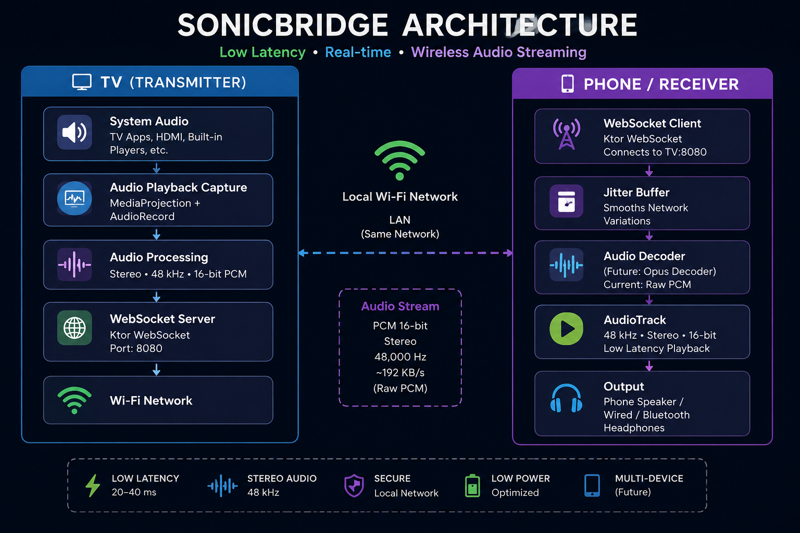

# SonicBridge Receiver

> Listen to Android TV audio wirelessly with low latency.

SonicBridge Receiver is the Android companion app for
[SonicBridge TV](https://github.com/noncoderf/Wifi-Sound-Transmitter-TV-App). It
connects to the TV over the local Wi-Fi network, receives raw PCM audio through
WebSocket, and plays it through the phone's audio output, wired headphones, or
Bluetooth headphones.

No cloud service or account is required.

## Features

- Connect to SonicBridge TV over local Wi-Fi
- Automatic local-subnet TV discovery
- Manual TV IP address entry
- Stereo 48 kHz, 16-bit PCM playback
- Low-latency streaming with Android `AudioTrack`
- Foreground media playback service
- Connection status and live transfer statistics
- Bytes-received counter and audio waveform visualizer
- Supports a TV server with multiple connected WebSocket receivers

## Architecture

`BT`text
Android TV
    |
    v
MediaProjection + AudioPlaybackCapture
    |
    v
AudioRecord: 48 kHz stereo PCM16
    |
    v
WebSocket binary frames
    |
    +---- Local Wi-Fi ----> SonicBridge Receiver
                                  |
                                  v
                              AudioTrack
                                  |
                                  v
                         Headphones / speakers
`BT`

## Requirements

- Android 8.0 / API 26 or newer
- SonicBridge TV installed and running on an Android TV
- Both devices connected to the same local Wi-Fi network

The TV app requires Android 10 / API 29 or newer because it uses
MediaProjection and Audio Playback Capture.

## Getting started

### 1. Start the TV transmitter

Install and open the
[SonicBridge TV](https://github.com/noncoderf/Wifi-Sound-Transmitter-TV-App)
app on Android TV. Select **Start Transmitting** and approve the MediaProjection
permission dialog.

The TV app starts its foreground streaming service and exposes its local IP
address.

### 2. Connect the receiver

Install and open SonicBridge Receiver on an Android phone using the same Wi-Fi
network.

The receiver first scans the local subnet for SonicBridge TVs. Select the TV
when it appears, or choose **Enter IP manually** and provide the TV's IP
address.

The receiver connects to:

`ws://<TV-IP>:8080/audio`

Example:

`ws://192.168.1.16:8080/audio`

### 3. Start playback

Tap **Connect**. The receiver starts its foreground playback service and plays
the incoming TV audio. Android 13 and newer may request notification permission
for the playback notification.

## Audio protocol

Each WebSocket binary frame contains one complete raw PCM packet. The receiver
does not expect a JSON header or compressed audio.

| Property | Value |
|---|---|
| Sample rate | 48,000 Hz |
| Channels | Stereo / 2 channels |
| Encoding | Signed 16-bit PCM |
| Byte order | Little-endian |
| Packet size | 1,920 bytes |
| Packet duration | 10 ms |
| Transport | WebSocket binary frames |
| Endpoint | `ws://<TV-IP>:8080/audio` |
| Port | `8080` |

Samples are interleaved:

`BT`text
left sample, right sample, left sample, right sample, ...
`BT`

The receiver writes the PCM packets directly to Android `AudioTrack` using
low-latency media playback settings.

## TV discovery

Discovery uses the phone's current IPv4 subnet. It probes port `8080` and then
performs a WebSocket handshake against `/audio` to identify a SonicBridge TV.

Discovery may fail when:

- The phone has no active Wi-Fi IPv4 address.
- The TV and phone are on different networks or isolated guest networks.
- The TV app is not currently transmitting.
- A router or firewall blocks local-device access.

Use manual IP entry when discovery is unavailable.

## Connection and playback behavior

- The selected TV IP is saved locally on the phone.
- The receiver reconnects to the selected TV when the app starts.
- Disconnecting stops the WebSocket and flushes the audio track.
- The TV transmitter keeps capture and per-client queues bounded to prevent
  stale audio from building up.
- If the network or receiver cannot keep up, the TV may drop old packets to
  preserve low latency.

The UI currently displays a latency field, but latency measurement is not yet
implemented and therefore reports `0 ms`.

## Troubleshooting

- Confirm the TV is transmitting before connecting.
- Confirm both devices are on the same Wi-Fi network.
- Verify the TV IP address shown by the TV app.
- Try manual IP entry if automatic discovery finds no TV.
- If there is no audio from one application, that application may block
  Android playback capture.
- Bluetooth output can add more delay than wired headphones.
- Repeated dropouts may indicate Wi-Fi congestion or an overloaded receiver.

## Security

The TV WebSocket endpoint is unencrypted and unauthenticated. Any device that
can reach port `8080` on the TV may connect and receive audio. Use both apps
only on a trusted local network.

## Tech stack

- Kotlin
- Jetpack Compose and Material 3
- Ktor WebSocket client
- Kotlin coroutines
- Android foreground service
- Android `AudioTrack`
- SharedPreferences for the selected TV address

## Project status

| Capability | Status |
|---|---|
| WebSocket receiver | Implemented |
| AudioTrack PCM playback | Implemented |
| Stereo 48 kHz PCM16 | Implemented |
| Foreground playback service | Implemented |
| Manual TV IP setup | Implemented |
| Automatic TV discovery | Implemented by subnet scan |
| Connection statistics | Implemented |
| Latency measurement | Planned |
| QR pairing | Planned |
| Secure pairing / encryption | Planned |
| Opus support | Planned |
| Equalizer and volume controls | Planned |

## Companion TV app

https://github.com/noncoderf/Wifi-Sound-Transmitter-TV-App

## Browser receiver on Vercel

The browser receiver connects directly from the hosted page to the TV:

```text
https://your-vercel-domain.example  →  ws://<TV-IP>:8080/audio
```

Vercel does not proxy or receive the audio stream. The browser and TV must be
on the same reachable local network, and the TV must be actively transmitting.

The browser flow uses manual TV IP entry. Enter the address shown by the TV,
choose **Use TV IP**, then press **Connect**. Hosted browser subnet scanning is
not used as the primary flow because browsers restrict large-scale local
network probing.

The page includes a `connect-src` policy allowing WebSocket connections, but a
Vercel response-header CSP can still override or tighten the HTML policy.

Current Chromium releases may show a Local Network Access permission prompt.
Choose **Allow** when the browser asks to find and connect to devices on the
local network. A denied permission must be changed in the browser's site
settings; page JavaScript cannot bypass it.

Firefox and Safari may block or restrict `ws://` connections from an HTTPS
page, and their Local Network Access permission behavior is not equivalent to
Chromium. Use a current Chromium browser or the native Android receiver when
direct browser access is unavailable.

Common causes of failure are an incorrect TV IP, the TV transmitter not being
started, Wi-Fi client isolation, different Wi-Fi networks, or a firewall
blocking port `8080`. The TV endpoint is intentionally unencrypted and local;
it is not exposed publicly.

## License

This project is licensed under the MIT License.

## Author

**Nizamuddin Ahmed**

- GitHub: https://github.com/noncoderf
- LinkedIn: https://linkedin.com/in/nizamuddin007
